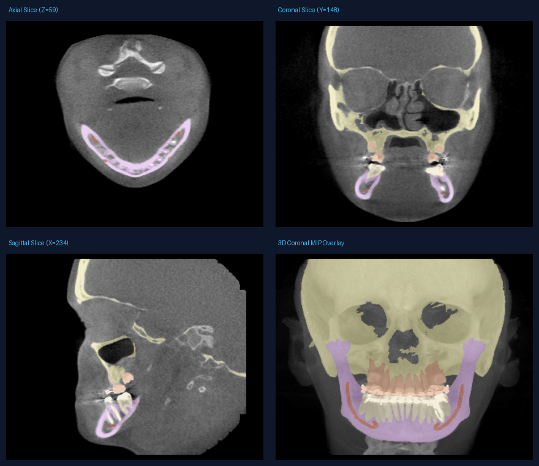

# Viscan Dental OPG Assistant

[](https://huggingface.co/spaces/surendra08/viscan-opg)
[](https://huggingface.co/surendra08/viscan-opg-weights)
[](https://opensource.org/licenses/BSD-3-Clause)

> **Clinical notice: AI-assisted findings for dentist review. Not a diagnosis.**

Upload a dental panoramic X-ray (OPG). The app draws coloured boxes around possible problem areas and gives you a short written list of what it found. It looks for four things:

| Finding | Plain meaning |
|---|---|
| `caries` | A cavity |
| `deep_caries` | A cavity that has gone deep, close to the nerve |
| `periapical_lesion` | An infection or dark area at the tip of a tooth root |
| `impacted_tooth` | A tooth stuck under the gum or bone |


*One test scan. Green is what the annotators marked; red is what the model found.*

This is a decision-support prototype built for the Viscan AI Engineer take-home assignment. It is meant to help a dentist take a second look. It does not replace a dentist, and the disclaimer appears in the UI, the JSON and the annotated report.

**Quick links**

- Live demo: https://huggingface.co/spaces/surendra08/viscan-opg
- Demo video (5-8 min, narrated): pending — to be recorded against this build
- Model weights: https://huggingface.co/surendra08/viscan-opg-weights
- Technical report: [REPORT.md](REPORT.md) (4-page PDF: [REPORT.pdf](REPORT.pdf))
- AI tool disclosure: [AI_DISCLOSURE.md](AI_DISCLOSURE.md)

**Run it in one command.**

```bash
git clone https://github.com/surendra902/viscan-opg.git && cd viscan-opg && docker compose up
```

Then open **http://localhost:8000** and drop an OPG onto the page. The first start downloads the 173 MB checkpoint and checks its checksum before loading it. Full setup options are in [Section 2](#2-run-it), the API in [Section 4](#4-using-the-api), and every command behind the numbers in [Section 5](#5-how-to-reproduce-every-number).

The live demo runs the same analysis service and the same web page on a free CPU server: `service.py` and `fdi.py` in the Space are byte-identical to this repository's, and its `app.py` differs only in the first-run checkpoint download and how it hands the app to uvicorn (the Space image ships with the weights). I re-checked those three files against the Space on 26 October 2026. On that server the 2D X-ray detector works fully, and the 3D part works only for the two bundled sample scans and for label maps you upload. Uploading a raw 3D CBCT scan there returns a clear "not available" message (HTTP 503) because the 3D model files are not installed on the free server. See [Section 6](#6-3d-cbct-bonus) for details.

---

## Contents

1. [What it does](#1-what-it-does)
2. [Run it](#2-run-it)
3. [Model weights and checksums](#3-model-weights-and-checksums)
4. [Using the API](#4-using-the-api)
5. [How to reproduce every number](#5-how-to-reproduce-every-number)
6. [3D CBCT (bonus)](#6-3d-cbct-bonus)
7. [Sample files](#7-sample-files)
8. [Testing](#8-testing)
9. [Licences](#9-licences)
10. [Known limits and next steps](#10-known-limits-and-next-steps)
11. [Project layout](#11-project-layout)
12. [Credits](#12-credits)

---

## 1. What it does

- **Accepts** PNG, JPG and single-frame 2D DICOM (`.dcm`) X-rays.
- **Checks the file first.** For DICOM it applies the right brightness/contrast settings (Modality LUT and VOI LUT windowing) and flips "inverted" images (MONOCHROME1) so bones look right. It rejects blank images, screenshots, text documents, colour photos, corrupt files and multi-frame DICOMs with a clear error message instead of crashing.
- **Finds** the four conditions above and returns the position of each in the original image's pixel coordinates, with a confidence score.
- **Numbers the tooth.** Each finding carries an estimated two-digit FDI tooth number — quadrant 1–4, then position 1–8 from the midline, so codes such as `24` or `47` rather than a 1–32 count — read from the box position against a geometry table fitted on DENTEX's own quadrant and tooth labels. It is labelled as an estimate everywhere it appears, because it is a position rule and not a tooth detector: on the validation split it is right on 0.976 of boxes for the quadrant and 0.543 for the exact number ([REPORT.md](REPORT.md) §3). The web page spells that notation out under the findings table, so `47` does not read as an out-of-range bug.
- **Draws** a box per finding, coloured by class and labelled with class name, confidence and the estimated tooth number.
- **Reports** the findings as JSON and as a one-line summary, for example "8 findings: 5 caries, 3 impacted tooth."
- **Shows** the original and annotated images side by side in a simple web page, with a confidence slider and download buttons.
- **Protects privacy.** Patient details in DICOM files are stripped and never appear in the output.
- **Accepts 3D CBCT scans** (bonus): segments the jaw and teeth, measures the distance between the lower teeth and the mandibular nerve canal, and exports 3D meshes you can view in the browser.

**How well it works, in four numbers.** On 50 X-rays the model never saw during training or tuning (182 labelled findings) it reaches **mAP@50 0.496**, **mAP@50:95 0.329** and **macro-F1 0.402** at the shipped confidence of 0.70. Only one of the four classes is usable: impacted teeth score F1 0.81, while caries, deep caries and periapical lesions sit at 0.37, 0.26 and 0.17 — treat the output as a highlighter that sometimes points at the wrong thing, not a filter that can clear a film. One CPU forward pass takes a **12.8 s median** (mean 14.9 s, range 9.2–25.2 s) at two threads and peaks at **1,048 MB** of RAM. Every one of those is a JSON file in `assets/eval/`, re-runnable with the commands in [Section 5](#5-how-to-reproduce-every-number); the per-class table, confusion matrix, failure cases and the same scan under four inference settings are in [REPORT.md](REPORT.md) §1, §2, §4 and §6.

---

## 2. Run it

### Option A: Docker Compose (one command)

```bash
git clone https://github.com/surendra902/viscan-opg.git
cd viscan-opg
docker compose up
```

Open **http://localhost:8000** in your browser. The first start downloads `best_model.pth` (173 MB) into the `viscan-checkpoints` volume and checks it against the SHA-256 in [Section 3](#3-model-weights-and-checksums) before loading it. The checkpoint is not baked into the image; the named volume keeps it across restarts. Results go to the `viscan-results` volume:

```bash
docker compose cp viscan:/app/results ./results
```

If the download fails, the app still starts, `/health` reports `model_loaded: false`, and `/analyze` returns HTTP 503.

The image installs CPU-only PyTorch and runs as a non-root user. It is built and tested on a clean Ubuntu runner on every push (`.github/workflows/docker-smoke.yml`): the job runs `docker compose up -d --build viscan`, waits for `/health` to report `model_loaded: true`, then runs `scripts/smoke_test.py` inside the container. The build log resolves `torch-2.14.1+cpu` and `torchvision-0.29.1+cpu`, so `requirements.txt` does not replace them with CUDA wheels.

### Option B: Python (development)

You need Python 3.10 or newer (tested on 3.11).

```bash
# 1. Get the code
git clone https://github.com/surendra902/viscan-opg.git
cd viscan-opg

# 2. Create a virtual environment
python -m venv venv
source venv/bin/activate          # Windows: .\venv\Scripts\activate

# 3. Install dependencies
pip install -r requirements.txt

# 4. Start the app (the first run fetches the checkpoint)
python app.py
```

The first start downloads `best_model.pth` (173 MB) from the weights repository and checks it against the SHA-256 in [Section 3](#3-model-weights-and-checksums) before loading it. That happens once. To skip the download, set `VISCAN_AUTO_DOWNLOAD=0` and place the file at `checkpoints/best_model.pth` yourself. If the download fails, the app still starts, `/health` reports `model_loaded: false`, and `/analyze` returns 503.

### Option C: Turn on live 3D CBCT inference locally

```bash
pip install -r requirements-cbct.txt

# Download Dataset112_DentalSegmentator_v100.zip from
# https://doi.org/10.5281/zenodo.10829675 (CC BY 4.0) and unzip it.
export VISCAN_CBCT_WEIGHTS_DIR=/path/to/extracted/folder
# The folder must contain dataset.json and fold_0/checkpoint_final.pth

python app.py
```

In Docker, put the extracted weights under `./cbct_weights` and start the CBCT service on port 8001:

```bash
docker compose --profile cbct up viscan-cbct
```

Check what is ready without uploading anything:

```bash
curl http://localhost:8000/health
```

`/health` reports `model_loaded` for the 2D model and a `cbct` block with `ready`, `nnunetv2_installed`, `weights_dir_configured`, `model_folder_found` and a plain-language `reason`. It does not reveal your folder paths.

---

## 3. Model weights and checksums

| File | Size | Checksum | Download | Licence |
|---|---|---|---|---|
| `best_model.pth` (2D OPG detector, Faster R-CNN) | 173,466,789 bytes (173.5 MB) | SHA-256 `e0b49b12f48fc71ec1f583db08f107650659571e7c2b9cbd454dbfed13b46a1f` | [Hugging Face](https://huggingface.co/surendra08/viscan-opg-weights) / [direct link](https://huggingface.co/surendra08/viscan-opg-weights/resolve/main/best_model.pth) | CC BY-NC-SA 4.0 |
| `Dataset112_DentalSegmentator_v100.zip` (3D CBCT model, used as-is) | 229,747,861 bytes (219.1 MB) | MD5 `b71cd5230168d28a4f71b078265b76be` | [Zenodo 10.5281/zenodo.10829675](https://zenodo.org/records/10829675) | CC BY 4.0 |

The app fetches the 2D checkpoint on first start, from either the Docker or the Python path, and verifies the SHA-256 above before loading it. The commands below are for manual or air-gapped installs.

**Verify your download:**

```bash
# Linux / macOS
sha256sum checkpoints/best_model.pth
# Expected: e0b49b12f48fc71ec1f583db08f107650659571e7c2b9cbd454dbfed13b46a1f

# Windows PowerShell
Get-FileHash checkpoints\best_model.pth -Algorithm SHA256
```

---

## 4. Using the API

The web page calls the same API you can call yourself.

### `POST /analyze` (2D OPG)

Send a multipart file (`PNG`, `JPG` or `.dcm`). Optional query parameter: `confidence_threshold` (default 0.70).

```bash
curl -X POST "http://localhost:8000/analyze?confidence_threshold=0.70" \
     -H "accept: application/json" \
     -F "file=@sample_opg.png"
```

**Example response** (shortened to 2 of 8 findings; recorded on CPU from `samples/sample_01_val_1_report.json`. `inference_ms` here is the whole request — file decode, input gate, model, annotation drawing and two PNG writes — and it is one recorded run; [REPORT.md](REPORT.md) §1 gives the measured ranges):

```json
{
  "image_id": "sample_01_val_1",
  "modality": "OPG",
  "model": { "name": "fasterrcnn_resnet50_fpn_v2", "version": "2.0.0" },
  "tooth_numbering": {
    "basis": "arch_geometry",
    "note": "tooth_fdi is a position-based estimate from fitted arch geometry, not a tooth detection: a wrong box or a wrong class gives a wrong number.",
    "fitted_on": "train (635 images of the 705-image pool, seed=42)",
    "dataset_revision": "7b27ccc8e342dcb774f69adc6ca5e6c09fefce93",
    "held_out_validation": { "n_boxes": 339, "fdi_exact": 0.5428, "quadrant": 0.9764, "tooth_digit": 0.5487 }
  },
  "inference_ms": 13009.3,
  "findings": [
    {
      "class": "impacted_tooth",
      "confidence": 0.99,
      "tooth_fdi": 26,
      "tooth_fdi_basis": "arch_geometry",
      "bbox": [1259.6, 171.7, 1394.7, 308.2]
    },
    {
      "class": "caries",
      "confidence": 0.94,
      "tooth_fdi": 35,
      "tooth_fdi_basis": "arch_geometry",
      "bbox": [1146.8, 467.0, 1316.2, 653.7]
    }
  ],
  "summary": "8 findings: 5 caries, 3 impacted tooth.",
  "original_image_url": "/samples/sample_01_val_1_input.png",
  "annotated_image_url": "/samples/sample_01_val_1_annotated.png",
  "three_d_available": false,
  "three_d_note": "No 3D model for a 2D OPG: a panoramic radiograph contains no volumetric data. Upload a CBCT volume (.nii, .nii.gz, or a zipped DICOM/NIfTI series) for 3D segmentation.",
  "disclaimer": "AI-assisted findings for dentist review. Not a diagnosis."
}
```

**Field guide**

| Field | Meaning |
|---|---|
| `class` | One of `caries`, `deep_caries`, `periapical_lesion`, `impacted_tooth` |
| `confidence` | How sure the model is, from 0 to 1 |
| `bbox` | `[x_min, y_min, x_max, y_max]` in the original image's pixels |
| `tooth_fdi` | Estimated FDI tooth number for that box: two digits, quadrant 1–4 then position 1–8 from the midline, so the value is always in 11–18, 21–28, 31–38 or 41–48. `null` if no geometry table is fitted |
| `tooth_fdi_basis` | Always `arch_geometry` today: the number comes from the box's position on the fitted arch, not from a tooth detector |
| `tooth_numbering` | Provenance for those numbers: what they are, which split fitted them, and the held-out accuracy. `null` when `assets/fdi/fdi_geometry.json` is missing |
| `inference_ms` | Time taken on the server, in milliseconds |
| `three_d_available` | Always `false` for a 2D X-ray |

`tooth_fdi` is the honest kind of extra: DENTEX labels each box with a quadrant and a tooth position, so I fitted those two axes into a geometry table and read a number off the box centre. It is not a tooth detector, the annotated PNG marks it `(est)`, and [REPORT.md](REPORT.md) §3 gives the measured accuracy while [Section 5](#5-how-to-reproduce-every-number) has the commands that rebuild it.

### Errors and limits

| Situation | What happens |
|---|---|
| Upload larger than `VISCAN_MAX_UPLOAD_MB` (default 1024 MB) | HTTP 413, rejected before decoding |
| Compressed 3D file expands past `VISCAN_MAX_NIFTI_DECOMPRESSED_MB` (default 2048 MB) or a ZIP past `VISCAN_MAX_ZIP_UNCOMPRESSED_MB` (default 4096 MB) | HTTP 400 with a limit message (protects against "zip bombs") |
| Wrong file type, corrupt image or DICOM, or a non-dental image | Structured 4xx error with a clear message |
| Valid image, nothing found | Empty `findings` list and the summary "No pathological findings detected at current confidence threshold." |
| 2D model weights not found | HTTP 503 |

### `POST /analyze` for 3D CBCT, and `POST /analyze/sample_cbct`

The same endpoint accepts 3D input. It decides what the file is by looking inside it (gzip/NIfTI header or ZIP contents), not by trusting the filename.

| What you upload | Where the labels come from | `segmentation_source` in the response | Did the model run in this request? |
|---|---|---|---|
| Raw `.nii` / `.nii.gz`, or a ZIP with a 3D DICOM series or a volume-only NIfTI | DentalSegmentator (needs the optional 3D setup and weights) | `model_inference` | Yes |
| A 5-class NIfTI label map, or a ZIP with volume plus label map | Labels you supplied | `uploaded_labelmap` | No |
| `POST /analyze/sample_cbct?scan=PostDentalSurgery` or `PreDentalSurgery` | Bundled demo files on the server | `demo_reference_labelmap` (Post) or `demo_model_labelmap` (Pre) | No |

```bash
# Raw volume, live model run (HTTP 503 if the 3D setup is not ready)
curl -X POST "http://localhost:8000/analyze" -F "file=@my_cbct.nii.gz"

# A pre-segmented label map
curl -X POST "http://localhost:8000/analyze" \
     -F "file=@samples/cbct/PostDentalSurgery_Segmentation.nii.gz"

# A bundled demo scan
curl -X POST "http://localhost:8000/analyze/sample_cbct?scan=PostDentalSurgery"
```

**Example 3D response** (shortened, from `samples/cbct/PostDentalSurgery_cbct_report.json`; meshes and images are generated per request):

```json
{
  "image_id": "PostDentalSurgery",
  "modality": "CBCT",
  "segmentation_source": "demo_reference_labelmap",
  "demo": true,
  "model": {
    "name": "DentalSegmentator_nnUNetv2_3d_fullres",
    "version": "v1.0.0 (Dataset112_DentalSegmentator, Dot et al. 2024)",
    "weights_doi": "10.5281/zenodo.10829675",
    "license": "CC BY 4.0",
    "pretrained_as_is": true,
    "inference_ran_in_this_request": false
  },
  "inference_ms": 9631.3,
  "timings_ms": { "load": 2427.9, "segmentation": null, "postprocess": 2454.9, "rendering": 269.0, "meshing": 4479.5, "total": 9631.3 },
  "memory": { "process_rss_before_mb": 345.7, "process_rss_after_mb": 598.0, "process_rss_delta_mb": 252.3, "gpu_peak_allocated_mb": null },
  "volume_metadata": {
    "dimensions_voxels": [360, 360, 330],
    "spacing_mm": [0.5, 0.5, 0.5],
    "segmented_structures": {
      "mandible": { "label_id": 2, "voxel_count": 309895, "volume_cm3": 38.74 },
      "mandibular_canal": { "label_id": 5, "voxel_count": 6655, "volume_cm3": 0.83 }
    }
  },
  "findings": [
    {
      "class": "mandibular_canal_to_lower_teeth_clearance",
      "hemimandible": "right",
      "min_distance_mm": 0.71,
      "closest_lower_tooth_mm": [59.5, 76.5, 45.0],
      "closest_canal_mm": [59.0, 76.5, 44.5],
      "bbox_3d_voxel": [108, 143, 79, 129, 163, 100]
    }
  ],
  "summary": "CBCT 5-structure segmentation complete (Maxilla, Mandible, Upper Teeth, Lower Teeth, Mandibular Canal). Right lower teeth-to-mandibular canal minimum clearance: 0.71 mm; Left lower teeth-to-mandibular canal minimum clearance: 1.58 mm.",
  "annotated_image_url": "/results/PostDentalSurgery_cbct_ortho.png",
  "mesh_glb_url": "/results/PostDentalSurgery_scene.glb",
  "mesh_stl_urls": { "mandible": "/results/PostDentalSurgery_mandible.stl" },
  "three_d_available": true,
  "disclaimer": "AI-assisted findings for dentist review. Not a diagnosis."
}
```

Every 3D response tells you honestly where the labels came from (`segmentation_source`), whether the model actually ran (`inference_ran_in_this_request`), the time per stage, and memory use. A `provenance.json` inside an uploaded ZIP is shown as **unverified** and can never make a response claim that the model ran.

---

## 5. How to reproduce every number

The dataset choice, data card, training setup, all eight pipelines, the tooth-number measurement and the failure analysis are in **[REPORT.md](REPORT.md)** — §1 headline metrics and speed, §2 results and confusion matrix, §3 tooth numbers, §4 one scan under four settings, §5 every configuration, §6 failure cases, §7 data card and training, §8 CBCT, §9 limits. This section is only the commands behind them, so a reviewer can re-run any number quoted there.

**Data and training** (needs the DENTEX download; ~10 GB):

```bash
python prepare_data.py data/dentex          # pinned revision, split seed 42, COCO-format labels
python train.py --config configs/baseline.yaml
```

`prepare_data.py` creates the 635 / 70 / 50 split and copies images into `images/{train,val,test}`. Training writes `runs/baseline/loss_curve.png`, `runs/baseline/val_ap_curve.png` and `checkpoints/best_model.pth`; the shipped checkpoint is epoch 8.

**Evaluation** — the 50-image test table, per-class precision/recall/F1, the confusion matrix and the five failure cases in REPORT §2 and §6:

```bash
python evaluate.py --weights checkpoints/best_model.pth --data_dir data/dentex
```

Failure images go to `evaluation_results/failures/`. Add `--tta hflip --dump_predictions preds_frcnn_tta` for the mirror-averaging run (P1), and `--config configs/retinanet.yaml --output_dir evaluation_retinanet --skip_variant --select_threshold val` for the RetinaNet that never converged.

**Tooth numbers** (REPORT §3) — `fit` prints the quadrant / tooth-digit / exact / within-one table and the 132-15-8 miss breakdown, writes both `fdi_geometry.json` artifacts, and `tests/test_fdi.py` fails if the breakdown stops adding up:

```bash
python scripts/dentex_fdi.py fetch          # range-reads 1.2 MB of labels out of the 10.9 GB zip
python scripts/dentex_fdi.py fit --json data/dentex/raw/train_quadrant_enumeration_disease.json
python scripts/dentex_fdi.py eval --json data/dentex/raw/train_quadrant_enumeration_disease.json
```

`eval` re-scores the shipped table without re-fitting it. The fitted table itself (5 kB of numbers) is committed, so a clean clone returns tooth numbers with no download step.

**Speed and memory** (REPORT §1 and §5) — every latency or memory number in this repository is one of these JSON files:

```bash
python scripts/benchmark_cpu.py --images samples --limit 5 --repeats 3 --threads 2 \
  --output assets/eval/cpu_latency_5_t2.json
python scripts/benchmark_cpu.py --images samples --limit 5 --repeats 3 --threads 10 \
  --output assets/eval/cpu_latency_5_t10.json
python scripts/benchmark_cpu.py --images samples --limit 5 --repeats 3 --threads 2 --tta both \
  --output assets/eval/cpu_latency_tta_paired_t2.json
python scripts/benchmark_cpu.py --images samples --limit 5 --repeats 2 --full-request \
  --output assets/eval/full_request_5_t2.json
python scripts/benchmark_cpu.py --images samples --limit 5 --repeats 2 \
  --service-url http://localhost:8000 --output assets/eval/live_request_latency.json
```

The `--tta both` form pairs the plain and mirrored pass of the same image in one process, which is the only TTA cost I quote; `--full-request` runs decode, gate, model, drawing and two PNG writes in one process and samples peak RSS every 0.25 s; the `--service-url` form needs `python app.py` running first. The `--threads 2` and `--threads 10` files are the same five images and the same single-pass timing, and they differ by 1.7× on the median (12.8 s → 7.6 s) and 1.8× on the mean (14.9 s → 8.3 s) — thread count alone moves latency more than any model change I measured, so every latency claim in this repository names the file and the thread count it came from. Two earlier runs over a 10-image held-out set are archived ([`cpu_latency_10_t2.json`](assets/eval/cpu_latency_10_t2.json), [`cpu_latency_10_t10.json`](assets/eval/cpu_latency_10_t10.json)) and quoted nowhere, because reproducing them needs the DENTEX images rather than the five bundled samples, and a different image mix is not the same measurement.

**The four-setting figure** (REPORT §4):

```bash
python scripts/compare_model_outputs.py --image samples/sample_02_val_10_input.png
```

**The experiment ladder** (REPORT §5) ran on Kaggle, not on this laptop. `kaggle_beat_benchmark_notebook.ipynb` is the executed P0–P7 run, `kaggle_notebook.ipynb` the training, evaluation, failure cases and the 960×1600 variant, and `kaggle_cbct_notebook.ipynb` the Post 3D run. Their pieces are re-runnable locally through `experiments/slice_inference.py`, `experiments/cascade_refine.py` and `experiments/ensemble_wbf.py`; `experiments/notebooks/` holds two unexecuted recipes kept for provenance and not used as evidence.

---

## 6. 3D CBCT (bonus)

CBCT is a 3D scan of the jaw. The same app accepts it, segments five structures (upper skull/maxilla, mandible, upper teeth, lower teeth, mandibular canal), measures the closest distance between the lower teeth and the nerve canal, and exports 3D meshes.

**What is mine and what is not.** The segmentation model is **DentalSegmentator** (nnU-Net `3d_fullres`, `fold_0`) by Dot et al. (Journal of Dentistry, 2024). I use it **as-is, with no extra training**. My work is the data loading, de-identification, cleanup, distance measurement, 3D mesh export, and browser viewer.

**Inputs accepted:** `.nii`, `.nii.gz`, a ZIP with a 3D DICOM series or NIfTI, a 5-class label map, or a ZIP with a volume plus label map. Patient tags are stripped from DICOM. Only voxels and spacing are kept.

**The 3D finding:** the app extracts the surface of the lower teeth (label 4) and the nerve canal (label 5), converts to millimetres using the scan's spacing, and finds the smallest gap using a nearest-neighbour search (`scipy` KD-tree). It reports the minimum per half of the volume. Tiny disconnected blobs under 60 mm³ are removed from the tooth and bone labels first because they are usually noise.

**Demo scans.** Two bundled scans come from 3D Slicer's "CBCT Dental Surgery" sample data (`PreDentalSurgery` and `PostDentalSurgery`, both 360 x 360 x 330 voxels at 0.5 mm). I make no claim that they are the same patient.

| | PreDentalSurgery | PostDentalSurgery |
|---|---|---|
| Label source | DentalSegmentator output shipped with the bundle (the run itself is not documented by an executed notebook here) | The published SlicerDentalSegmentator reference mask, after my 60 mm³ filter |
| Closest tooth-to-canal distance, side A | 2.12 mm | 0.71 mm |
| Closest tooth-to-canal distance, side B | 1.50 mm | 1.58 mm |

"Side A / side B" is the left/right half of the voxel grid. I did **not** map it to the patient's real left and right using the scan orientation, so verify laterality before any clinical use. The API field is still called `hemimandible` for schema stability.



That panel is the app's own output, not a figure drawn for this README: `render_cbct_ortho_views` in [cbct_pipeline.py:951](cbct_pipeline.py#L951) writes the same 2×2 reconstruction for every CBCT request, and the three slices it picks are the axial, coronal and sagittal positions of the finding with the shortest tooth-to-canal gap — here Z=59, Y=148 and X=234. The Post scan of the same panel is in [REPORT.md](REPORT.md) §8.

The model's own accuracy on the Post scan (model output compared with the reference mask) was a mean Dice of 0.964: maxilla 0.977, mandible 0.985, upper teeth 0.987, lower teeth 0.975, mandibular canal 0.897. These were measured in an executed Kaggle notebook, and the shipped Post demo labels are the reference mask itself, not a model prediction.

**Speed and memory.** One full model run on a Kaggle Tesla T4 (Post scan) takes 131.4 s of 3D inference over 252 tiles, 5.8 s of post-processing and distance work, and 0.9 s of meshing, with a peak of 4,936 MB of GPU memory and 2,642 MB of process RAM. The pre-segmented demo bundles skip the network: about 9.6 s (Post) and 10.4 s (Pre) per request on a local CPU, with about 250 MB extra RAM, so those figures are not comparable to the 131 s one. The Pre bundle's `run_metrics.json` is not backed by an executed notebook, so I do not report its timing or memory. Full provenance and file hashes are in [`samples/cbct/PROVENANCE.md`](samples/cbct/PROVENANCE.md).

**Meshes.** The local sample files were made on a machine without `scikit-image`, so they use a simple fallback mesher and are large (28.7 MB and 35.1 MB). The Hugging Face Space installs `scikit-image` and uses Marching Cubes, which gives smaller files. The Pre scan cross-section panel is above; the Post one is in [REPORT.md](REPORT.md) §8.

**How I would run this in production (a design plan, not built or benchmarked):**

1. Upload straight to cloud storage with a signed link, and strip DICOM patient tags before storing.
2. Make it an asynchronous job: the API returns "accepted" immediately, a queue (Redis/Celery) runs the job on a GPU worker, and progress streams to the browser.
3. Keep GPU workers warm with the model loaded, one job per GPU, and scale by queue length. Speed-ups like FP16 or TensorRT are plausible but not measured.
4. Shrink and compress the 3D files (Draco) and serve them from a CDN.

**3D limits.**
- The distance is a straight-line gap between voxel surfaces on a 0.5 mm grid. It is not a traced nerve path and not a surgical risk score.
- Raw CBCT jobs run one at a time (a process lock) because they need several GB of memory.
- If the 3D model is missing, the app returns HTTP 503 with setup instructions. It never silently substitutes demo data.
- The ZIP loader sorts slices along the scan direction but does not correct tilted (oblique) scans.

---

## 7. Sample files

- **2D OPG:** `samples/sample_01..05_*` each hold the input image, the annotated image, and the JSON from `/analyze` at threshold 0.70. To regenerate:

  ```bash
  python generate_samples.py --weights checkpoints/best_model.pth \
    --images samples/sample_01_val_1_input.png samples/sample_02_val_10_input.png \
             samples/sample_03_val_11_input.png samples/sample_04_val_14_input.png \
             samples/sample_05_val_21_input.png \
    --names sample_01_val_1 sample_02_val_10 sample_03_val_11 sample_04_val_14 sample_05_val_21 \
    --output samples
  ```

  Each `*_report.json` is the response the shipped service returned for the `*_input.png` sitting next to it — the current bundles were generated by feeding those five files back in, so a reviewer can reproduce them without downloading DENTEX. Re-running the command over the shipped inputs is a no-op on the images and rewrites the reports and annotated pictures. Every finding in them carries `tooth_fdi` and `tooth_fdi_basis`, and the response carries the `tooth_numbering` provenance block. The `inference_ms` in each file is one recorded request from that run, not a benchmark; [REPORT.md](REPORT.md) §1 gives the measured spread, which on this machine is wide. Run one batch of this at a time: it is CPU-saturating work, and a second process over the same `samples/_tmp` directory both contaminates the timings and deletes files the first one is using.

- **3D CBCT:** `samples/cbct/` holds the two demo bundles, preview images, 5 STL files, a GLB scene, the recorded JSON, and `PROVENANCE.md`. To regenerate:

  ```bash
  python build_cbct_bundles.py && python generate_cbct_samples.py
  ```

---

## 8. Testing

```bash
pytest tests/ -v

# end-to-end check against a running server (default http://localhost:8000)
python scripts/smoke_test.py
```

`pytest` covers DICOM brightness settings and MONOCHROME1 flipping, box clipping, API response shapes, the tooth-numbering geometry (FDI convention, quadrant order, monotone tooth digits, clipping, and the rule that the shipped table is fitted on train and measured on a split it never selected on), NIfTI read/write, hand-checked nerve distances, STL/GLB export, and the 3D rules above: files are routed by content, a 2D result never claims 3D, uploaded label maps never claim the model ran, uploaded `provenance.json` is not trusted, demo scans are labelled as demos, patient tags are stripped, and raw 3D input returns 503 without weights. One test stands in for the real 3D model to prove the wiring and provenance work. It does **not** test the model's accuracy.

`scripts/smoke_test.py` runs 9 checks against a live server and sends it 7 files: a bundled sample with findings (expects 200, at least one box, and an integer `tooth_fdi` plus a `tooth_numbering` provenance block on every finding), a sample with no findings (200 and an empty list), a text file (400), a corrupt DICOM (422, because it parses as a DICOM with no pixel data), a red 512 × 512 PNG that is not a dental X-ray (422), a continuous-tone grayscale 2:1 PNG (200 — the heuristic gate cannot tell it from a radiograph, so this check records the documented false accept) and a synthetic MONOCHROME1 DICOM carrying `DOE^JOHN` and `PHI-TEST-123` (200, and the check fails if either string appears anywhere in the response). It exits non-zero if any response differs. It needs the model loaded, so start the server first.

Both were last run on this laptop on 26 October 2026 against `python app.py` on Windows: `pytest tests/ -q` ended `73 passed, 5 warnings` and `python scripts/smoke_test.py` ended `9 passed, 0 failed`, with the tooth-number check reporting `8/8 findings carry an FDI number; basis=arch_geometry, held-out exact=0.5428`.

The report's page limit is checked the same way as the code: `python scripts/render_report_pdf.py` re-renders `REPORT.md` through Chrome, prints where each page's content ends and exits non-zero if `REPORT.pdf` goes past four pages, which is the brief's 2–4 page limit. Its last run printed `words: 3690  pages: 4`.

---

## 9. Licences

| Part | Licence | Can it ship in a commercial product? |
|---|---|---|
| My code, API, Dockerfile | BSD-3-Clause | Yes |
| Faster R-CNN and COCO starting weights (torchvision) | BSD-3-Clause | Yes |
| PyTorch, torchvision, NumPy, SciPy, scikit-image, trimesh, matplotlib, nibabel, FastAPI, Uvicorn, pydicom, Pillow, psutil | BSD / MIT / HPND | Yes, with attribution |
| nnU-Net v2 | Apache-2.0 | Yes, with attribution |
| DentalSegmentator weights (3D) | CC BY 4.0 | Yes, with credit |
| **DENTEX dataset and my fine-tuned 2D weights `best_model.pth`** | **CC BY-NC-SA 4.0** | **No. Non-commercial research and evaluation only.** A commercial product would need retraining on commercially cleared data or a licence from the DENTEX authors. |
| DENTEX images in `samples/` and the figures derived from them | CC BY-NC-SA 4.0 | No. Included for evaluation and demonstration only; the BSD-3-Clause licence covers the code, not these images. |
| Ultralytics YOLO (not used) | AGPL-3.0 | Only if you open-source your service or buy an enterprise licence |
| CBCT demo scans (3D Slicer sample data) | Slicer BSD-style licence | Confirm with the Slicer project before commercial reuse |

In short: the code and architecture could ship commercially, but the trained 2D weights could not without new data.

---

## 10. Known limits and next steps

**Limits**


- `tooth_fdi` is a position estimate, not a tooth detection: it reads the box centre against a geometry table fitted on DENTEX train boxes, and it is only right on 0.543 of validation boxes (0.976 get the quadrant right, 0.932 get the quadrant and land within one tooth position). A wrong box or a wrong class carries the wrong number with it, and the annotated PNG says `(est)` for that reason. The number itself is always a legal FDI code — never 9 or 53 — but legal is not the same as correct.
- The detector labels four findings only, because that is all DENTEX labels. No restorations, root-canal fillings, missing teeth or bone loss ([REPORT.md](REPORT.md) §7).
- The test set is small (50 images), so per-class numbers are rough.
- The "is this a dental X-ray?" check uses simple image rules (aspect ratio, colour, contrast, histogram), not a trained classifier, so unusual X-rays may be wrongly rejected.
- Trained on one dataset only. Performance on other clinics' machines is unknown.
- No class weighting or oversampling was used for rare classes.
- 3D side labels are not mapped to the patient's real left and right.
- Upload limits protect a single demo server. They are not a plan for many simultaneous users.

**With two more weeks**

1. **Rebalance the rare classes** with focal loss or repeat-factor sampling for periapical lesion and deep caries, and use gradient accumulation at higher resolution to fix the batch-size-1 problem.
2. **Make tooth numbers anatomical rather than geometric**: detect and number the teeth themselves (a tooth-instance stage, or the FDI-labelled tooth polygons in the Zhou et al. set) so `tooth_fdi` comes from the anatomy in the image instead of the position of a lesion box.
3. **Add classes DENTEX cannot supply** — restorations, root-canal fillings, missing teeth, bone loss — by training on a second annotated set such as Zenodo record 15487430, with a published class map, per-source licences recorded in the data card, and the DENTEX 50-image test split kept untouched as the only test set.
4. **Speed up CPU inference** by exporting to ONNX Runtime with INT8 quantisation, aiming well below the 12.8 s median on two threads measured in `assets/eval/`.
5. **Label individual teeth in 3D** by combining DentalSegmentator with ToothFairy2 instance segmentation to report third-molar position next to the nerve distance.

---

## 11. Project layout

| File or folder | What it is |
|---|---|
| `app.py`, `service.py` | The web app and the FastAPI endpoints |
| `imaging.py`, `input_gate.py` | Loading images and DICOM, and the "is this a dental X-ray?" check |
| `fdi.py` | The arch-geometry table behind `tooth_fdi`: fit, assign and load |
| `model.py`, `train.py`, `evaluate.py` | The detector, training and testing |
| `prepare_data.py` | Downloads and splits DENTEX |
| `cbct_pipeline.py`, `build_cbct_bundles.py`, `generate_cbct_samples.py` | 3D scan processing and demo bundles |
| `generate_samples.py` | Rebuilds the 2D sample outputs |
| `configs/` | One settings file per training run |
| `samples/` | Example inputs and outputs (2D and 3D) |
| `assets/eval/` | Charts and measured latency/accuracy JSON used in this README and the report |
| `assets/fdi/fdi_geometry.json` | The fitted tooth-numbering table the service loads at startup |
| `tests/` | Automated tests |
| `scripts/` | CPU latency benchmark (model-only, full-request and live-server modes, with peak-memory sampling), the four-setting output comparison figure, the DENTEX tooth-label fetch/fit/measure tool, the end-to-end smoke test, and the REPORT.md → PDF renderer |
| `kaggle_*.ipynb` | Executed Kaggle notebooks (main, beat benchmark, CBCT) |
| `experiments/` | Extra experiments ([Section 5](#5-how-to-reproduce-every-number), [REPORT.md](REPORT.md) §5): sliced inference, WBF fusion, the crop checker, and two unexecuted notebook recipes kept for provenance |
| `REPORT.md`, `REPORT.pdf` | Technical report. `python scripts/render_report_pdf.py` rebuilds the PDF and exits non-zero if it no longer fits four pages; it needs Google Chrome plus `markdown` and `pymupdf`, which are documentation tools and deliberately not in `requirements.txt`. |
| `RESEARCH_BENCHMARKS.md` | DENTEX leaderboard context |
| `AI_DISCLOSURE.md` | Which AI tools I used and for what |
| `Dockerfile`, `docker-compose.yml` | Container setup |

---

## 12. Credits

- **DENTEX dataset:** Hamamci et al., MICCAI 2023.
- **DentalSegmentator:** Dot et al., *Journal of Dentistry*, 2024. Weights: Zenodo [10.5281/zenodo.10829675](https://doi.org/10.5281/zenodo.10829675).
- **nnU-Net:** Isensee et al., *Nature Methods*, 2021.
- **Faster R-CNN and RetinaNet implementations and COCO weights:** PyTorch / torchvision.
- **CBCT sample scans:** 3D Slicer "CBCT Dental Surgery" sample data.
- **Other datasets compared:** Zhou et al., BMC Oral Health, 2024; Tufts Dental Database.

*AI-assisted findings for dentist review. Not a diagnosis.*
