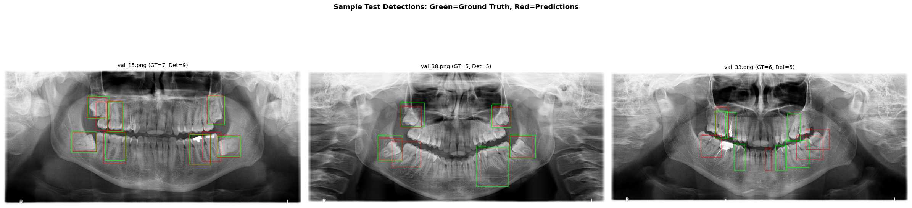
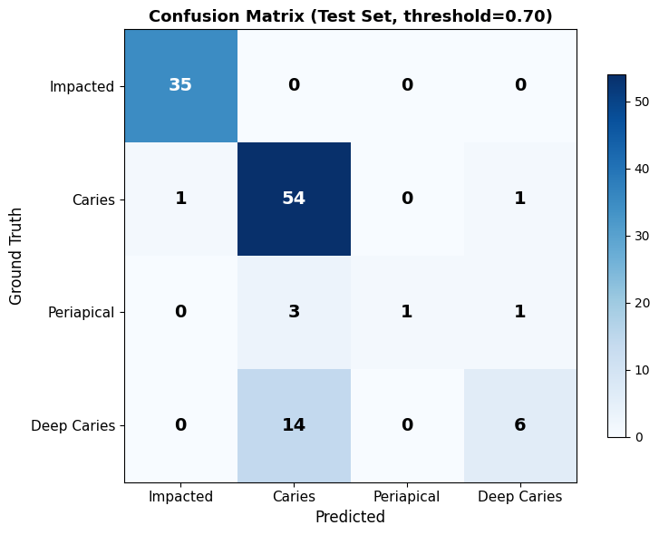
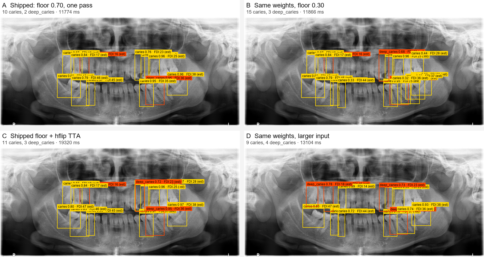
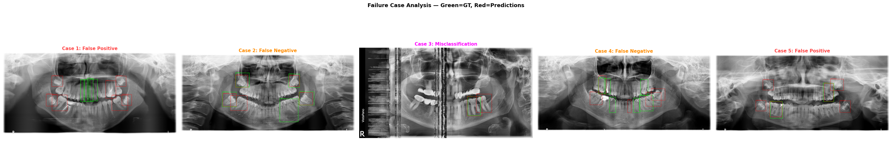
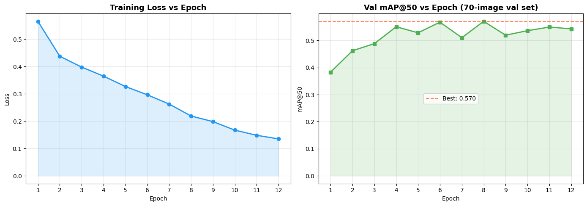
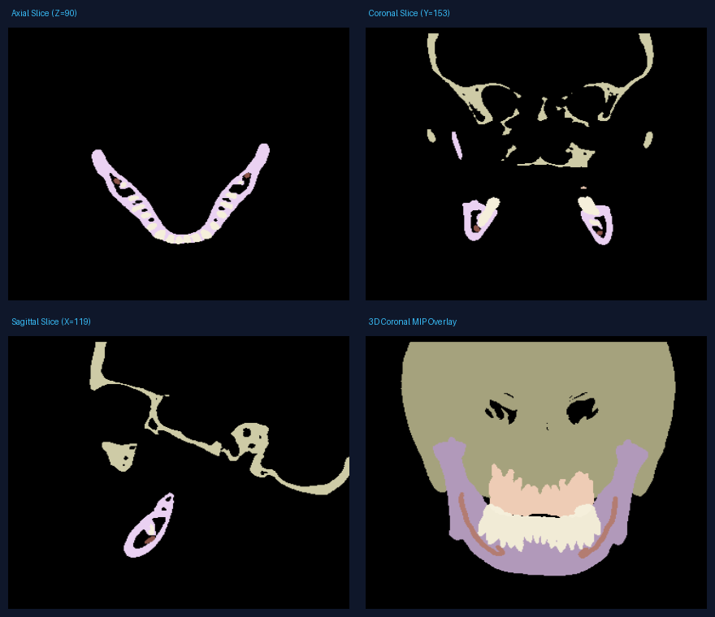

# Viscan: Dental Finding Detection in Panoramic X-rays

Technical report for the AI Engineer (Round 2) take-home assessment. 2D OPG track, plus a bonus 3D CBCT track.

**Candidate:** Surendra Goud · **Date:** 26 October 2026 · **Code:** [github.com/surendra902/viscan-opg](https://github.com/surendra902/viscan-opg), branch `main`, tagged `submission` (`git rev-parse submission^{}` gives the exact commit) · **Kaggle runs:** commit `1ac1080` · **Weights:** `best_model.pth`, 173,466,789 bytes, SHA-256 `e0b49b12f48fc71ec1f583db08f107650659571e7c2b9cbd454dbfed13b46a1f` · **Demo:** [huggingface.co/spaces/surendra08/viscan-opg](https://huggingface.co/spaces/surendra08/viscan-opg) · **Video:** not recorded yet

> **Clinical disclaimer:** AI-assisted findings for dentist review. Not a diagnosis. This build is not clinically ready and has not been validated on clinical data.

## 1. What it is, and how well it works

Viscan takes one panoramic dental X-ray and returns boxes for four findings — impacted tooth, caries, deep caries, periapical lesion — each with a confidence, an estimated FDI tooth number, an annotated image and a one-line summary. The same `/analyze` endpoint also accepts a 3D CBCT scan (§8). The detector is Faster R-CNN ResNet-50 FPN V2 (COCO_V1 starting weights), 43.3 M parameters, fine-tuned for 12 epochs on DENTEX 2023 and served on CPU.

On 50 images the model never saw during training or tuning (182 labelled boxes) it scores **mAP@50 0.496**, **mAP@50:95 0.329** and **macro-F1 0.402** at the shipped threshold of 0.70. One class is usable and three are not: impacted teeth reach F1 0.81, while caries, deep caries and periapical lesions sit at 0.37, 0.26 and 0.17. Read the output as a highlighter that sometimes points at the wrong thing, never as a filter that can clear a film.



*One test scan, both layers: green is what the annotators marked, red what the model found at 0.70. The positions are often close; the counts are not.*

**Speed.** Latency on this laptop moves more than any model change I measured, so I only quote numbers archived as JSON in the repository. Two threads, five bundled samples, three runs each: **mean 14.9 s, median 12.8 s per forward pass, range 9.2–25.2 s** ([`cpu_latency_5_t2.json`](assets/eval/cpu_latency_5_t2.json)); the same command run again straight afterwards gave mean 15.0 s ([`cpu_latency_5_t2_run_b.json`](assets/eval/cpu_latency_5_t2_run_b.json)). A full request — decode, gate, model, drawing, two PNG writes — measured **14.8 s mean over ten requests, 10.5–22.6 s** in one process with no HTTP server ([`full_request_5_t2.json`](assets/eval/full_request_5_t2.json)). Peak resident memory, sampled every 0.25 s: **1,072 MB** full request, **1,048 MB** model-only, on a 24 GB machine. Even the fast session is too slow for a clinic queue, so production would load once, serve one request at a time, report readiness on `/health` and fail closed with 503 rather than invent a result.

## 2. Results on the 50 held-out images

| Class | Test boxes | AP@50 | AP@50:95 | Precision | Recall | F1 at 0.70 |
|---|---:|---:|---:|---:|---:|---:|
| `impacted_tooth` | 40 | 0.833 | 0.541 | 76.1% | 87.5% | **0.81** |
| `caries` | 101 | 0.358 | 0.244 | 27.7% | 53.5% | 0.37 |
| `deep_caries` | 32 | 0.457 | 0.302 | 42.9% | 18.8% | 0.26 |
| `periapical_lesion` | 9 | 0.336 | 0.230 | 33.3% | 11.1% | 0.17 |

*The 0.81-to-0.17 range is the result; the mean of those four F1s is the 0.402 headline. Boxes are usually near the right place but not drawn tightly: AP@50 0.496 against AP@75 0.383, AR@100 0.683.*



*Rows are the annotators' class, columns the model's. Only the 116 true boxes a prediction landed on appear — the 66 it never found are outside the picture — and 96 of the 116 kept the right class. The errors run one way: 14 deep caries become ordinary caries, 3 of the 5 periapical lesions found are called caries too, and no impacted tooth is confused with anything. Matching is class-aware at IoU ≥ 0.50, so a right-place, wrong-class box counts against both classes.*

**Where the errors land.** Of 182 true boxes: 96 found with the right class, 20 with the wrong class, 66 missed. At 0.70 the model also produced 142 false alarms in 44 of the 50 images, 124 of them caries.

**Operating point.** I swept confidence 0.10–0.90 on the 70 validation images, picked 0.70 where validation macro-F1 peaked at 0.556, then read the test set once. Test macro-F1 there is 0.402. One global floor suits rare classes badly; per-class thresholds were not run.

## 3. The tooth numbers, and what the two digits mean

FDI numbers teeth with two digits, not with a count from 1 to 32. The first is the quadrant — 1 upper right, 2 upper left, 3 lower left, 4 lower right — and the second the position from the midline, 1 at the central incisor through 8 at the third molar, so codes run 11–18, 21–28, 31–38 and 41–48. `47` is a lower-right second molar and `48` the highest code that exists; one film images all four quadrants, so a report can legitimately carry `16` and `45`. Quadrants are named for the patient, so quadrant 1 is the left half of the film as you look at it — the convention DENTEX's own labels follow.

`fdi.py` fits an arch-geometry table on the 3,190 training boxes — one midline threshold, one arch-level threshold, one centroid per tooth position per quadrant — and reads a code off each box centre. Its single knob, tuned on a one-in-five image holdout inside train, came out `v_weight = 0.0`: horizontal position alone wins. Three commands cover it: `scripts/dentex_fdi.py fetch` range-reads 1.2 MB of annotation JSON out of the 10.9 GB archive over HTTP 206, `fit` fits the table on train and scores it on validation, and `eval` re-scores the shipped table without re-fitting it.

| Check, on 339 validation ground-truth boxes | Accuracy |
|---|---:|
| Correct quadrant | 0.976 |
| Correct tooth digit | 0.549 |
| Correct two-digit code | 0.543 |
| Correct quadrant **and** within one tooth position | 0.932 |

*Of the 155 wrong boxes, 132 are one tooth position out inside the right quadrant, 15 are two or more out, and only 8 cross the midline or the arch line. The estimator is rarely on the wrong side of the mouth; it is often on the next tooth over.*

`fit` prints those numbers, both `fdi_geometry.json` artifacts store them, and `tests/test_fdi.py` fails if the breakdown stops adding up or the two files disagree. The 5 kB table ships in the repository, so a clean clone returns tooth numbers with no download step. Treat all of this as the ceiling of a position rule, not of the product: it is scored on expert boxes, so a detected box inherits every detection error, caries boxes often straddle two teeth, and an impacted tooth that never erupted has no correct code to hit. The `FDI 47 (est)` on the sample films is an estimate, and the field stays `null` when the table is missing rather than being guessed.

## 4. The same scan under four settings

What the settings in §5 do to one real film — `sample_02_val_10_input.png`, a held-out test image — scored with the shipped checkpoint and drawn by the app's own code in all four panels. Only the named setting changes.



| Panel | Setting | Findings | Wall time here | What it shows |
|---|---|---:|---:|---|
| A | shipped: floor 0.70, one pass | 12 — 10 caries, 2 deep | 11.8 s | what a dentist actually sees today |
| B | same weights, floor 0.30 | 18 — 15 caries, 3 deep | 11.9 s | how much the 0.70 floor suppresses |
| C | floor 0.70 + horizontal-flip TTA | 14 — 11 caries, 3 deep | 19.3 s | the measured best change, at 1.64× panel A here |
| D | same weights, min 960 / max 1600 input | 13 — 9 caries, 4 deep | 13.1 s | resolution on its own, with the weights fixed |

*Panel A is the shipped behaviour and reproduces `samples/sample_02_val_10_report.json` finding for finding. The floor is a pure filter: B holds all 12 of A's boxes unchanged (IoU 1.0 on every one) plus six more, all caries-family. Mirror averaging keeps all 12 at the same class and tooth number, adds two and nudges five by a few pixels (IoU 0.91–0.95) — it moves boxes rather than fixing them. Panel D is where the diagnosis wobbles: 10 of A's 12 come back, two merge into neighbours and three survivors flip caries → deep caries, without finding anything new. That is isolation, not a win, and not the 960×1600 training run of §5, where the weights changed too. No panel found an impacted tooth or a periapical lesion on this film. Regenerate with `python scripts/compare_model_outputs.py`, which writes every box to `assets/eval/model_output_variants.json`.*

## 5. Every configuration I ran

P0–P7 come from one executed Kaggle T4 session at commit `1ac1080` (`kaggle_beat_benchmark_notebook.ipynb`, 17/17 code cells with outputs), which first reproduced the shipped baseline with drift ≤ 0.0004. Thresholds and pipelines were selected on validation; the test set was read once per pipeline.

| Pipeline | Test AP | Test AP@50 | Δ AP@50 vs P0 | Test F1 at its own τ |
|---|---:|---:|---:|---:|
| **P0 baseline (shipped)** | 0.3293 | 0.4961 | — | 0.4016 at 0.70 |
| P1 same weights + hflip TTA | 0.3446 | 0.5281 | +0.0320 | 0.3988 at 0.80 |
| P2 full view (hflip TTA) + native-scale tiles | 0.2189 | 0.3557 | −0.1404 | 0.2896 at 0.35 |
| P3 P2 + RetinaNet, WBF | 0.1790 | 0.3015 | −0.1946 | 0.2661 at 0.30 |
| P4 P2 + crop checker, re-score | 0.2211 | 0.3589 | −0.1372 | 0.3543 at 0.40 |
| P5 P3 + crop checker, re-score | 0.1936 | 0.3168 | −0.1793 | 0.3172 at 0.40 |
| P6 P2 + crop checker, re-label | 0.1700 | 0.2715 | −0.2246 | 0.3184 at 0.25 |
| P7 P3 + crop checker, re-label | 0.1437 | 0.2356 | −0.2605 | 0.2320 at 0.30 |

*Only P1 beat the baseline, and not at a setting I would run: +0.032 AP@50 for twice the forward passes, with F1 at its own validation-selected threshold slightly below the baseline's. Everything else lost 0.137–0.261 AP@50. I ship P0.*

**What P1 costs on CPU.** `scripts/benchmark_cpu.py --tta both` times the plain and mirrored passes as paired runs of the same image in one process, alternating which runs first: the mirror pass takes **1.936×** the single pass (per-image median 1.979×, range 1.618–2.121×; [`cpu_latency_tta_paired_t2.json`](assets/eval/cpu_latency_tta_paired_t2.json)). The unpaired version, timed in separate processes, gave a lower ratio that did not survive pairing.

**Why the rest lost, and one more resolution run.** P2 tiles an 800 px crop at about twice the object size the model learned and overflowed the 300-box cap. P3's RetinaNet was undertrained, not shown to be worse: alone it scored AP 0.053 and AP@50 0.095, with validation mAP@50 still climbing at 0.0783 in epoch 12/12. The crop checker helped slightly as a re-scorer (+0.003 AP@50 over P2) and hurt as a re-labeller (0.272); its 92.1% is training accuracy on its own crop bank, not held-out. A separate 960×1600 training, from `kaggle_notebook.ipynb` rather than this ladder, drew tighter boxes (AP@75 0.410 vs 0.383) and found impacted teeth better (AP@50 0.915 vs 0.833) but lost overall (AP@50 0.493, AP 0.313) and on deep caries (0.365); its batch size changed too, so resolution is not isolated there — panel D above is.

## 6. Failure cases



*At most one case per image, exported from Cell 9 of `kaggle_notebook.ipynb`. The reasons below are hypotheses I did not test.*

| # | Image | What happened | Likely reason |
|---|---|---|---|
| 1 | `val_4` | False alarm: impacted tooth, score 0.99, IoU 0.00 | Confident about back-of-jaw anatomy the annotators did not mark; unlabelled third molars are plausible. |
| 2 | `val_38` | Missed a periapical lesion | Rare class (144 training boxes); only 1 of 9 found at this setting. |
| 3 | `val_3` | Deep caries called caries, score 0.97 | Box right, severity wrong; 14 of the 20 class swaps are this pair. The film carries heavy vertical banding. |
| 4 | `val_33` | Missed a caries | Caries recall is 53.5% and the scan is shrunk 0.47×, so a small between-teeth cavity is the expected casualty. |
| 5 | `val_13` | False alarm: impacted tooth, score 0.99, IoU 0.00 | Same error as case 1; the repeat suggests the model's most confident mistake, not a one-off. |

These five are the model's most *confident* errors; its most frequent one — caries false alarms, 124 of them — is too common to make the list and shows only in the §2 totals.

## 7. Data card, model choice and training

**Dataset.** DENTEX (MICCAI 2023, CC BY-NC-SA 4.0) is the only public dataset with expert boxes for all four required findings, so it is the only one I trained on: Hugging Face `ibrahimhamamci/DENTEX`, revision `7b27ccc8e342dcb774f69adc6ca5e6c09fefce93`, pinned so the data cannot change underneath a run. Zhou et al. (2024) merges the caries classes and has no impaction label; the Tufts database is restricted access.

**Split.** DENTEX has 705 labelled training-archive images and 50 official validation images with labels; I did not use the 250 challenge-test images. My working set is 755 images and 3,711 boxes, split with seed 42, and the test set is the official 50-image validation set.

| Split | Images | Boxes | Impacted | Caries | Periapical | Deep caries | Used for |
|---|---:|---:|---:|---:|---:|---:|---|
| Train | 635 | 3,190 | 545 | 2,004 | 144 | 497 | teaching the model |
| Validation | 70 | 339 | 59 | 185 | 14 | 81 | epoch and threshold selection |
| Test | 50 | 182 | 40 | 101 | 9 | 32 | final scores only |
| **Total** | **755** | **3,711** | 644 | 2,290 | 167 | 610 | |

*The test set is small — 9 periapical and 32 deep-caries boxes — so a handful of images can move a per-class score, which is why §2 prints each class next to its box count.*

**Leakage.** The 70 validation images were drawn from the 705-image pool with a seeded shuffle, and I checked in code that no filename appears in two splits. DENTEX carries no patient identifiers, so I cannot rule out one patient appearing in two splits.

**Preparation.** The films are 1,976–3,139 px wide (mean 2,830) and 976–1,536 px high (mean 1,367), shrunk to fit 800 × 1333 — about 0.47× on average, which is what makes small lesions hard. DENTEX boxes `[x, y, w, h]` are clipped and converted to corner form; no classes were merged. DICOM files apply the modality LUT before the VOI LUT, and MONOCHROME1 images are inverted. An input gate rejects blank, corrupt, colour, portrait and screenshot-like files before inference — hand-written rules, not a trained classifier. Augmentation: random horizontal flip (50%), brightness/contrast jitter (±15%). Raw data is not in the repository; `prepare_data.py` fetches and prepares it.

**Class imbalance.** Caries outnumbers periapical lesions about 14 to 1 in training. I used no class weights and no oversampling; the only imbalance-aware choices are per-class reporting and one global threshold. That is a limitation, not a solution (§9).

**Label depth.** Every DENTEX box carries three levels — quadrant (`category_id_1`), tooth position (`category_id_2`), diagnosis (`category_id_3`) — and the diagnosis level has exactly the four classes above. Restorations, root-canal fillings, missing teeth and bone loss are unlabelled here, so they are neither in the model nor reported. Zenodo record 15487430 does carry them (1,808 OPG JPEGs, 14 YOLO classes) but adds a non-commercial line to its CC BY 4.0 licence, and merging it is a retrain with a published class map.

**Model choice.** I compared two options on paper and trained the first: Faster R-CNN R50-FPN V2 (43.3 M parameters, BSD-3-Clause, COCO starting weights) against Ultralytics YOLO11n (about 2.6 M, AGPL-3.0, not trained). DENTEX's own reference run is a Faster R-CNN, so it is a like-for-like check and the licence avoids YOLO's AGPL obligation; the cost is a larger, slower model. There is no measured architecture comparison here — the RetinaNet I did train never converged.

**Training.** `configs/baseline.yaml`: fine-tuned from COCO-pretrained weights, seed 42 with deterministic mode, SGD (learning rate 0.005, momentum 0.9, weight decay 0.0005), cosine schedule, 12 epochs, batch size 2, mixed precision on a Kaggle Tesla T4, input 800 × 1333. The best checkpoint is epoch 8 (validation mAP@50 0.570, mAP@50:95 0.360). Low-scoring boxes are kept internally (`box_score_thresh=0.001`) so the precision-recall curves are complete; the 0.70 floor is applied afterwards.



*Loss falls the whole way down; validation mAP@50 does not. It peaks at 0.570 (epochs 6 and 8) and then goes flat and noisy, so the last four epochs bought nothing and epoch 8 is what ships.*

To rebuild the numbers above: `python prepare_data.py data/dentex`, then `python train.py --config configs/baseline.yaml`, then `python evaluate.py --weights checkpoints/best_model.pth --data_dir data/dentex`, and `python scripts/compare_model_outputs.py` for the §4 figure. README §5 lists every command, including the experiment scripts.

**Intended use and safety.** A research prototype for a dentist-facing review workflow. It highlights candidate regions and does not diagnose; the confidence score ranks findings rather than giving the probability of disease, `tooth_fdi` is labelled an estimate in the JSON and on the drawn box, and patient tags are stripped from DICOM.

## 8. Bonus: 3D CBCT

The same `/analyze` endpoint accepts `.nii`, `.nii.gz` and ZIP archives of a CBCT scan. DentalSegmentator (Dot et al., 2024) is used as-is, without training, to segment five structures: upper jaw, mandible, upper teeth, lower teeth and mandibular canal. My work is loading, patient-tag removal, 60 mm³ island cleanup, distance measurement, mesh export and the browser viewer.

The finding is the smallest straight-line gap between the lower teeth and the nerve canal, per half of the volume: 0.71 mm and 1.58 mm on the Post-surgery demo scan, 2.12 mm and 1.50 mm on Pre. The halves are a voxel midpoint split, not the patient's real left and right, and the gap is not a traced nerve. A full Post run on a Tesla T4 takes 131.4 s of inference over 252 tiles, 5.8 s of post-processing and 0.9 s of meshing, peaking at 4,936 MB of GPU memory. The Post labels are the published SlicerDentalSegmentator reference mask, matched at mean Dice 0.964 (canal 0.897); the Pre labels have no reference mask, so no Dice is reported, and the two scans are not claimed to be the same patient. Pre-segmented bundles skip the network (about 9.6 s Post and 10.4 s Pre on CPU); the Pre bundle's `run_metrics.json` is not backed by an executed notebook, so I do not report it.



*The Post demo scan as the app renders it. The free Hugging Face Space has no 3D model, so raw uploads there return HTTP 503 and only the two bundled scans work — demo data is never substituted for a failed inference. The production plan (queued jobs, warm GPU workers, compressed meshes) is a design in README §6, not a benchmark.*

## 9. Limits, next work, and how to reproduce

**Licensing.** Code is BSD-3-Clause. DENTEX and the fine-tuned `best_model.pth` are CC BY-NC-SA 4.0, so the weights are non-commercial and a product would need retraining on cleared data; the DENTEX images in `samples/` and the figures drawn from them carry the same terms. DentalSegmentator weights are CC BY 4.0, the Slicer demo scans BSD-style, runtime libraries MIT, BSD, Apache-2.0 or HPND, and YOLO11n (AGPL-3.0) was not used. The code could ship commercially; the trained 2D weights could not.

**Limits.** Rare classes are the main weakness: periapical recall 11.1% and deep-caries recall 18.8% at 0.70, with 14 of 32 deep boxes called shallow, and caries precision 27.7%. No class balancing, one global threshold. The tooth number is a geometry estimate right on 0.543 of validation boxes, not an anatomical reading. Four classes only, one dataset, and 2D projection overlap cannot separate anatomy from lesions. The input gate is hand-written rules, so unusual X-rays can be wrongly rejected. 3D side labels are not mapped to the patient's real left and right. The repo is public, while the brief asked for a private repository with reviewer access granted — a snapshot mirror exists for review, and visibility is a one-click change. The narrated demo video is not recorded.

**With two more weeks.** Per-class confidence settings tuned on validation (1–2 days); class-balanced loss and oversampling for the rare classes (about a week); RetinaNet on a schedule suited to 635 images (2–3 GPU days); ONNX export with INT8 quantisation (3–5 days, target unmeasured); a tooth-detection stage so `tooth_fdi` comes from the anatomy rather than a box centre (about two weeks); and a second annotated dataset for the classes DENTEX does not label. Mirror averaging is the cheap detection extra (+0.032 AP@50 at 1.94× the single-pass CPU time, §5), which is why I still ship the single pass.

**Reproduce.**

```bash
docker compose up              # or: python app.py
python scripts/smoke_test.py   # after the server is up
pytest tests/ -q
```

The first start fetches and SHA-256-verifies the 173 MB checkpoint. The Python path, smoke test, tooth-number fit, CPU benchmarks and this PDF ran on Windows with Python 3.11; the Docker image is built and smoke-tested on a clean Ubuntu runner in `.github/workflows/docker-smoke.yml`, not here. AI tools are listed in [AI_DISCLOSURE.md](AI_DISCLOSURE.md), and README §5 has every command behind the numbers in this report.

**References.** Hamamci et al., DENTEX, MICCAI 2023. Dot et al., DentalSegmentator, *J. Dentistry* 2024 (Zenodo 10.5281/zenodo.10829675). Isensee et al., nnU-Net, *Nat. Methods* 2021. Akyon et al., SAHI, arXiv:2202.06934. Solovyev et al., Weighted Boxes Fusion, 2021. Lin et al., COCO, ECCV 2014.
